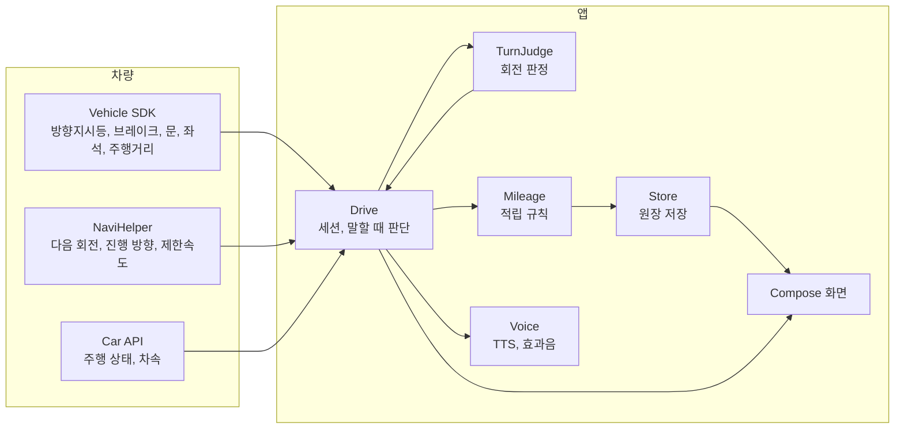

<div align="center">

# 블루 패밀리

**가족 안전운전 마일리지**

현대차그룹 차량용 앱 개발 공모전 출품작


[APK 받기](apk/블루패밀리_release.apk) | [시연 영상](.github/readme/demo.mp4) | [설치와 실행](#설치와-실행) | [시연 순서](#시연-순서)

<br>


</div>

## 요약

블루 패밀리는 운전 중 방향지시등과 전 좌석 안전벨트를 지키면 마일리지를 주는 Pleos Connect 앱입니다. 가족이 결합한 현대차와 기아 차량이 많을수록 모든 적립에 최대 30%를 더 줍니다.

| 항목 | 내용 |
|---|---|
| 사용자 | 현대차와 기아 차량을 타는 가족의 운전자 |
| 판정 | 방향지시등, 안전벨트, 과속, 급제동 |
| 화면 | 탭 4개(마일리지, 이번 운전, 가족, 설정), 동의 화면, 주행 중 화면 |
| 사용 SDK | Pleos Vehicle, NaviHelper, TextToSpeech, AAOS Car API |
| 저장 | 기기 안 파일 1개 |

## 문제 정의

2026년 9월 테슬라 모델Y가 국내 차종 판매 1위에 올랐고, 1~9월 누적에서도 쏘렌토와 1,810대 차이입니다. 차 성능과 가격만으로는 고객의 다음 구매를 지키기 어려워졌고, 고객이 현대차그룹의 서비스 안에 머물게 하는 생태계 락인(lock-in)이 중요해졌습니다.

| 항목 | 값 | 출처 |
|---|---|---|
| 2026년 9월 국내 차종 판매 | 테슬라 모델Y 11,421대, 그랜저 8,898대, 쏘렌토 6,957대 | [겟차, 산업통상부 9월 자동차산업 동향 인용](https://web.getcha.kr/blog/tesla-model-y-sales-first-place) |
| 2026년 1~9월 누적 | 쏘렌토 74,933대, 모델Y 73,123대 | 같은 자료 |
| 2026년 8월 테슬라 수입차 점유율 | 34.9%. 2월부터 7개월 연속 수입 브랜드 1위 | [헤럴드경제 2026-09-02](https://www.heraldk.com/article/2026090220504410941) |
| 2025년 국내 전기차 판매 | 기아 60,609대, 테슬라 59,893대, 현대차 55,461대 | [뉴스와 2026-02-19](https://www.news-wa.com/article/automobiles/new-car/2026/02/19/20260219500065) |

현대차그룹의 포인**트는 차를 사**거나 정비할 때 쌓이고, 운전할 때는 쌓이지 않습니다. 2026년 블루멤버스 패밀리 멤버십으로 가족이 포인트를 나눠 쓸 수 있게 됐지만, 적립 경로는 그대로입니다. 블루 패밀리는 운전 기록으로 포인트를 쌓고, 가족결합 혜택의 조건을 안전운전에 둡니다.

| 근거 | 내용 | 출처 |
|---|---|---|
| 위험운전과 사고 | 사고 운전자의 위험운전은 무사고 운전자의 약 1.5배 | [정책브리핑 2022-05-20](https://www.korea.kr/news/policyNewsView.do?newsId=148901825) |
| 부모와 자녀의 운전 | 부모의 위험운전 빈도가 높을수록 자녀도 높고, 기록을 가족에게 보여 주면 줄어듦 (166가구, 12개월) | [Taubman-Ben-Ari 외 2014](https://cris.iucc.ac.il/en/publications/the-contribution-of-parents-driving-behavior-family-climate-for-r/) |
| 블루멤버스 패밀리 멤버십 | 2026년 도입, 가족 최대 8명이 포인트를 실시간 공유 | [헤럴드경제 2026-04-30](https://www.heraldk.com/article/2026043018051757030) |

## 주요 기능

### 주행 중 화면


차가 달리기 시작하면 화면은 "운전 중입니다" 한 줄로 바뀌고 애니메이션이 꺼집니다. 판정은 화면과 별개로 계속 돌고, 결과는 정차한 뒤 음성과 화면으로 알립니다.

### 이번 운전 탭


왼쪽에는 사람이 앉은 좌석마다 안전벨트를 맸는지 보여 줍니다. 오른쪽에는 탄 사람 수와 그날 기록으로 계산한, 이번 운전에서 받을 수 있는 마일리지를 보여 줍니다.

차가 착석을 감지하지 못하는 좌석은 목록에서 빠지고 적립과 감점에서도 빠집니다. Virtual Console에는 벨트를 매는 조작이 없어 에뮬레이터에서는 모든 좌석이 "안 맴"으로 보입니다.

### 마일리지 탭


앱을 열거나 운전을 마치면 이 탭이 먼저 보입니다. 쓸 수 있는 마일리지, 그날 적립, 등급과 다음 등급까지 남은 마일을 보여 줍니다. 적립 내역은 날짜별로 묶고, 늦게 켠 회전은 그 운전 줄 아래에 적습니다.

정차하면 "회전 3번 중 2번 깜빡이를 제때 켰습니다. 44마일이 쌓였습니다"처럼 음성으로 알립니다. 놓친 회전이 있으면 "좌회전은 30미터 전에 켜면 됩니다"를 덧붙입니다.

### 가족 탭


가족 초대 코드로 결합하면 마일리지 지갑을 함께 씁니다. 결합 차량 수, 결합 추가 적립 비율, 가족별 안전 점수와 감점 항목을 보여 줍니다. 위치, 경로, 감점 시각과 장소는 가족에게 보내지 않습니다. 공유를 끄면 결합 추가 적립도 멈춥니다.

### 동의와 설정

| 동의 | 설정 |
|---|---|
|  |  |
| 처음 실행하면 쓰는 정보와 쓰는 곳을 두 줄로 보여 줍니다. "동의하고 시작"을 눌러야 판정을 시작합니다. | 효과음과 음성 안내를 끌 수 있고, 기록과 마일리지는 두 번 확인한 뒤 지웁니다. 시연 도구로 회전 안내를 재생하고 지난 6일 기록을 채웁니다. |

## 판정 기준

차량 신호와 내비 안내로 판정합니다. 차로 변경은 Pleos SDK가 차선 정보를 주지 않아 판정하지 않습니다.

| 항목 | 기준 | 신호 |
|---|---|---|
| 내비 안내 회전 | 일반 도로는 회전 30m 전, 고속도로(제한속도 80km/h 이상)는 100m 전에 같은 방향 방향지시등이 켜져 있음 | 방향지시등(Vehicle), 다음 회전과 거리(NaviHelper) |
| 내비 없는 회전 | 10초 안에 진행 방향이 60도 넘게 바뀌면 회전으로 보고, 바뀌기 전 5초 안에 방향지시등이 켜져 있었는지 봄 | 방향지시등(Vehicle), 진행 방향(NaviHelper) |
| 과속 | 제한속도보다 20km/h 넘게 3초 이상. 넘은 구간 하나를 1번으로 셈 | 차속(`PERF_VEHICLE_SPEED`), 제한속도(NaviHelper) |
| 급제동 | 브레이크를 밟은 채 초당 11km/h 넘게 감속 | 브레이크 페달(Vehicle), 차속 |
| 벨트 풀림 | 달리는 중에 사람이 앉은 좌석의 벨트가 풀림 | 좌석별 안전벨트, 좌석 착석(Vehicle Seat) |

내비 안내 회전은 회전 지점 50m 안까지 온 뒤 다음 안내로 넘어가면 회전한 것으로 봅니다. 경로를 재탐색하면 그 회전은 판정하지 않습니다.

## 마일리지 규칙

### 적립

적립은 운전 한 번이 끝날 때 계산합니다.

| 항목 | 조건 | 마일 |
|---|---|---|
| 주행 거리 | 운전 한 번에 달린 거리 | 1km당 1 |
| 안전 배수 | 최근 7일 방향지시등 준수율 95% 이상 | 주행 거리 마일 2배 |
| 내비 안내 회전 | 방향지시등을 제때 켬 | 회당 5 |
| 내비 없는 회전 | 방향지시등을 제때 켬 | 회당 2 |
| 전 좌석 안전벨트 | 운전 내내 앉은 모든 좌석이 벨트를 맴 | 10, 동승 좌석당 5 추가 |
| 감점 없는 날 | 그날 마친 운전에 감점이 없음 | 하루 20 |
| 7일 연속 | 감점 없는 날이 7일 이어짐 | 100 |
| 결합 추가 적립 | 결합 차량 2대 10%, 3대 20%, 4대 이상 30% | 그 운전의 적립에 더함 |

하루 상한은 300마일이고 결합 추가 적립은 상한에 넣지 않습니다. 감점 없는 날은 하루 한 번 주고, 그 뒤에 감점이 생겨도 회수하지 않습니다.

### 감점

안전 점수는 매주 100점에서 시작합니다. 감점은 안전 점수만 깎고 마일리지는 깎지 않습니다.

| 과속 | 급제동 | 방향지시등 놓침 | 벨트 풀림 |
|---|---|---|---|
| 5점 | 3점 | 3점 | 5점 |

### 등급

| 등급 | 조건 |
|---|---|
| 그린 | 시작 등급 |
| 실버 | 누적 3,000마일, 최근 30일 방향지시등 준수율 90% 이상 |
| 골드 | 누적 10,000마일, 최근 90일 동안 운전한 날의 95% 이상이 감점 없는 날 |

### 사용처

마일리지는 차가 아니라 사람에게 쌓여서, 차를 바꿔도 현대차나 기아를 고르면 그대로 이어집니다.

| 사용처 | 방식 |
|---|---|
| 현대차, 기아 새 차 구매 | 차 값 할인 |
| 현대카드 M포인트 | M포인트로 전환 |
| 블루멤버스 | 패밀리 멤버십 포인트로 전환 |
| 블루핸즈 | 정비 요금 할인 |
| E-pit | 충전 요금 할인 |
| 보험 안전운전 특약 | 안전 점수를 할인 근거로 제출 |

제휴 협의 전이라 앱 화면에는 사용처를 두지 않았습니다.

## 안전 설계

공모전이 안내한 Pleos 개발자 가이드의 주행 중 동작 기준에 맞춰 화면을 만들었습니다.

| 가이드 기준 | 구현 |
|---|---|
| 주행 중 1~2초 안에 파악, 애니메이션 금지 | `CarUxRestrictions`가 주행 중을 알리면 전환 효과 없이 한 줄 화면으로 바꾸고, 앱 전체의 애니메이션을 끕니다 |
| 운전에 필요한 안내만 | 정차(차속 0.5m/s 미만) 중이거나, 브레이크와 방향지시등이 꺼져 있고 다음 회전이 500m 넘게 남았을 때만 말합니다. 2분 넘게 미룬 안내는 버립니다 |
| 오디오 포커스 | 음성과 효과음 모두 `GAIN_TRANSIENT_MAY_DUCK`으로 포커스를 받아 내비 안내와 겹치지 않게 합니다 |
| 텍스트 입력 없음 | 주행 중에는 입력을 받지 않고, 정차 후에도 스위치와 버튼만 씁니다 |
| 대비 4.5:1 이상 | 어두운 테마 기준 본문 16.3:1, 보조 글자 7.8:1, 파란 버튼 위 흰 글자 4.5:1 이상. 파란 강조 글자(4.1:1)는 24sp 이상 큰 글자에만 씁니다 |
| 한 손 조작 | 누르는 영역은 모두 88dp 이상입니다 |
| CCP 미지원 선언, Back은 `moveTaskToBack` | 매니페스트에 `ROTARY_SUPPORTED=false`를 선언했고, 최상위 화면에서 뒤로 가기를 누르면 앱을 닫지 않고 뒤로 보냅니다 |
| 위치 사용은 명시적 동의 | "동의하고 시작" 버튼으로만 동의를 받고, 위치는 내비 없는 회전의 진행 방향 판정에만 씁니다. 마이크는 쓰지 않습니다 |

## 디자인

어두운 바탕에 강조색으로 파란색 하나만 씁니다(`ui/Theme.kt`). 파란색은 탭, 버튼, 스위치와 화면마다 하나인 핵심 숫자, 벨트를 맨 좌석에만 칠합니다. 본문은 1~2초 안에 읽히도록 28sp로 키웠고, 한국어는 낱말 단위로 줄을 바꿉니다.

<details>
<summary>색과 모션</summary>

| 토큰 | 밝은 테마 | 어두운 테마 |
|---|---|---|
| 배경 | `#F4F5F9` | `#121317` |
| 반투명 판 | 흰색 70% | 흰색 8% |
| 본문 | `#16171B` | `#EEF0F3` |
| 보조 글자 | `#5B5F6B` | `#A3A8B4` |
| 강조 | `#2F6BFF`에서 `#1D4ED8`로 그라데이션 | 같음 |

| 모션 | 동작 |
|---|---|
| 누름 | 버튼과 탭을 누르면 95%로 줄었다가 돌아오고 짧게 진동합니다 |
| 누른 자리 빛 | 누른 자리에 빛이 번지고, 손을 떼면 0.3초 동안 사라집니다 |
| 선택 표시 이동 | 탭을 바꾸면 파란 선택 표시가 옮겨 갑니다. 스위치 손잡이도 같습니다 |
| 숫자 | 잔액과 그날 적립은 자리마다 40ms씩 늦게 굴러갑니다 |
| 목록 등장 | 탭을 열면 항목이 40ms 간격으로 위에서부터 나타납니다 |
| 주행 중 | 진행 중인 모션을 바로 끝 상태로 바꾸고 누름 효과도 멈춥니다 |

</details>

## 설치와 실행

| 준비물 | 값 |
|---|---|
| 에뮬레이터 | Pleos Connect v2.1.0 (Android 14, API 34, 2560×1440) |
| APK | [`apk/블루패밀리_release.apk`](apk/블루패밀리_release.apk) (release 빌드, 40MB). [Releases](https://github.com/wjdtkdgns777/blue-family-private/releases/latest)에도 같은 파일이 있습니다 |
| 차량 값 조작 | Pleos Connect Virtual Console (`http://127.0.0.1:8088/`) |

APK를 설치합니다.

```bash
adb install -r apk/블루패밀리_release.apk
```

Virtual Console을 쓰려면 포트를 연결합니다.

```bash
adb forward tcp:8088 tcp:8088
```

앱 서랍에서 블루 패밀리를 열고 "동의하고 시작"을 누른 뒤, 이어서 뜨는 차속(위치 그룹) 권한을 허용합니다. 차량 전용 앱(`android.hardware.type.automotive`)이라 휴대폰 에뮬레이터에는 설치되지 않습니다.

에뮬레이터 내비는 실제로 움직이지 않아서, 회전 안내를 재생하는 시연 도구를 release 빌드의 설정 탭에도 넣었습니다. 서명은 Android 기본 디버그 키로 했습니다.

직접 빌드하려면 다음 명령을 씁니다. Pleos SDK는 `https://nexus-playground.pleos.ai/repository/maven-releases/`에서 받고, JDK는 Android Studio에 들어 있는 JBR을 씁니다(`JAVA_HOME` 지정).

```bash
./gradlew :app:assembleRelease
```

## 시연 순서

시작 전에 Virtual Console에서 충전구(Charge Port)를 닫고, 조수석 착석은 켜고 뒷좌석 착석은 꺼 둡니다.

| 순서 | 앱 | Virtual Console |
|---|---|---|
| 1 | 설정 탭에서 "지난 6일 기록 채우기" | Door Position: Close |
| 2 | 설정 탭에서 "회전 안내 재생" 시작 | |
| 3 | 주행 중 화면으로 바뀜 | Gear: N, 속도를 20~50km/h 사이에서 바꿔 가며 달림 |
| 4 | | 재생 5초에 Turn Signal: Blink right, 20초에 Off |
| 5 | | 재생 50초에 Blink left(늦게 켬), 53초에 Blink right |
| 6 | | 재생 66초에 Off, Odometer를 12km 올림 |
| 7 | | 브레이크를 떼고 속도를 0으로 줄인 뒤 BRAKE, Gear: P |
| 8 | 요약 음성과 함께 마일리지가 오름. 이번 운전, 가족 탭 확인 | Door Position: Open |

기어를 D로 넣으면 에뮬레이터가 내비를 앞으로 띄워서 N으로 시연합니다. 주행거리계는 앞으로만 움직이므로 입력된 값보다 큰 값을 넣습니다. 에뮬레이터 속도는 계단처럼 바뀌어서, 브레이크를 밟은 채 속도를 내리면 급제동으로 잡힙니다.

## 구조



| 파일 | 하는 일 |
|---|---|
| `Drive.kt` | 차량 리스너를 모아 운전 한 번(세션)을 열고 닫습니다. 과속, 급제동, 좌석별 안전벨트, 말할 때 판단을 맡습니다. Pleos Vehicle SDK 2.3.2가 착석 값을 반대로 넘겨서 여기서 뒤집어 씁니다 |
| `TurnJudge.kt` | 내비 안내 회전과 내비 없는 회전을 판정합니다 |
| `Mileage.kt` | 운전 한 번이 끝나면 적립 거래를 만들고, 하루 상한을 적용하고, 같은 운전이 두 번 적립되지 않게 거래마다 고유 번호를 붙입니다 |
| `Store.kt` | 원장을 `AtomicFile`로 저장합니다. 진행 중인 운전도 바뀔 때마다 저장해서, 앱이 꺼져도 다음 실행 때 정산합니다 |
| `Voice.kt` | 기기 안(ON_DEVICE) TTS, 효과음, 오디오 포커스 |
| `ui/` | 화면 6개, 디자인 토큰, 공통 컴포넌트 |

| 영역 | 사용 |
|---|---|
| 언어, UI | Kotlin 2.2, Jetpack Compose (BOM 2026.09.00) |
| 차량 | Pleos Vehicle 2.3.2, AAOS Car API (`CarUxRestrictionsManager`, `CarPropertyManager`) |
| 내비 | Pleos NaviHelper 3.0.5 |
| 음성 | Pleos TextToSpeech 3.3.1 (ON_DEVICE, 네트워크 불필요) |
| 저장 | `AtomicFile` JSON, `SharedPreferences` |
| 빌드 | AGP 9.4, minSdk 28, targetSdk 37 |
