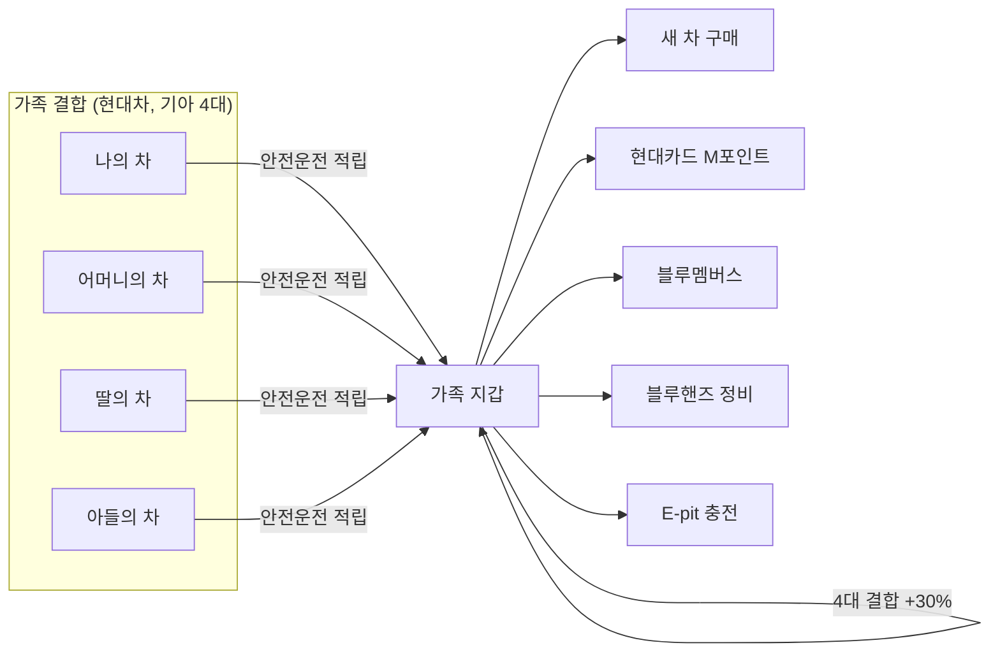
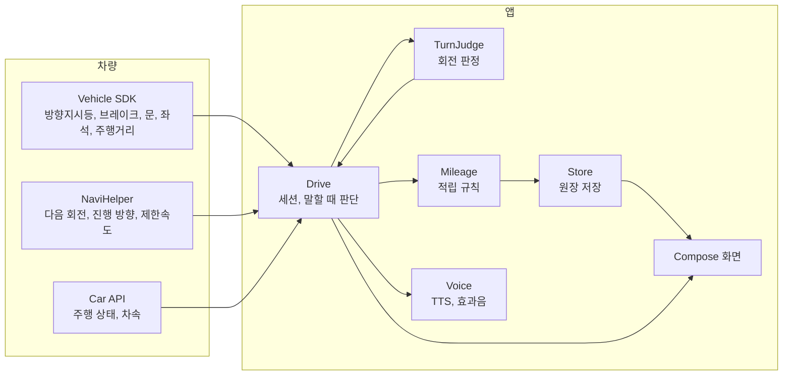

<div align="center">

# 블루 패밀리

**통신사처럼, 자동차도 가족결합**

가족이 안전하게 운전한 만큼 함께 쌓고, 현대차와 기아를 더 많이 결합할수록 더 크게 쌓는 마일리지

현대차그룹 차량용 앱 개발 공모전 출품작


[APK 받기](apk/블루패밀리_release.apk) | [시연 영상](.github/readme/demo.mp4) | [설치와 실행](#설치와-실행) | [시연 순서](#시연-순서)

<br>


</div>

## 요약

블루 패밀리는 현대차그룹의 첫 가족결합 서비스를 차 안에서 시작하는 Pleos Connect 앱입니다. 가족이 각자 차에서 방향지시등을 제때 켜고 전 좌석 안전벨트를 매면 가족 지갑 하나에 마일리지가 쌓입니다. 결합한 현대차와 기아 차가 늘수록 모든 적립에 최대 30%가 더 붙습니다.

| 항목 | 내용 |
|---|---|
| 사용자 | 현대차와 기아를 타는 가족의 운전자 모두 |
| 판정 | 방향지시등, 전 좌석 안전벨트, 과속, 급제동 |
| 결합 혜택 | 결합 차량 2대 10%, 3대 20%, 4대 이상 30% 추가 적립 |
| 사용처 | 새 차 구매, 현대카드 M포인트, 블루멤버스, 블루핸즈, E-pit (제휴 협의 전) |
| 사용 SDK | Pleos Vehicle, NaviHelper, TextToSpeech, AAOS Car API |

## 문제 정의

### 차 한 대로는 고객을 지키기 어려워졌습니다

2026년 9월 테슬라 모델Y가 국내 차종 판매 1위에 올랐고, 1~9월 누적에서도 쏘렌토와 1,810대 차이입니다. 차의 성능과 가격만으로는 고객의 다음 구매를 지키기 어렵고, 고객이 현대차그룹의 서비스 안에 머물게 하는 생태계가 필요합니다.

### 통신사는 가족을 묶는데, 자동차는 묶지 못합니다

통신사는 가족결합 할인으로 가족 전체를 한 회사에 묶습니다. 결합을 깨면 할인반환금을 물어야 해서, 한 사람이 떠나려 해도 가족 모두의 할인이 걸립니다. 한 가족은 휴대폰처럼 차도 여러 대 타지만, 그 차들을 한 브랜드로 묶는 장치는 없습니다. 2026년에 나온 블루멤버스 패밀리 멤버십도 가족이 포인트를 나눠 쓰게 할 뿐, 가족이 현대차와 기아를 더 많이 탈수록 커지는 혜택은 없습니다. 포인트도 여전히 차를 사거나 정비할 때만 쌓이고, 가장 오래 머무는 운전 시간에는 쌓이지 않습니다.

### 결합 조건을 요금이 아니라 안전운전에 둡니다

블루 패밀리는 결합의 조건을 안전운전에 둡니다. 가족이 마일리지를 더 모으려 할수록 가족 모두의 운전이 안전해집니다. 가족은 서로의 이번 주 안전 점수를 보며 운전을 챙겨 주고, 부모의 운전 습관은 자녀에게 이어지기 때문에 그 효과는 다음 세대까지 갑니다.

| 받는 쪽 | 얻는 것 |
|---|---|
| 현대차그룹 | 가족의 다음 차가 현대차나 기아일 이유. 결합 차량이 늘수록 다른 브랜드로 옮기기 어려워집니다 |
| 가족 | 평소 운전으로 쌓이는 마일리지와 차량 대수만큼 커지는 결합 혜택 |
| 사회 | 위험운전이 줄어 사고가 줄어듭니다 |

| 근거 | 내용 | 출처 |
|---|---|---|
| 국내 차종 판매 | 2026년 9월 모델Y 11,421대, 그랜저 8,898대, 쏘렌토 6,957대 | [겟차, 산업통상부 9월 자동차산업 동향 인용](https://web.getcha.kr/blog/tesla-model-y-sales-first-place) |
| 테슬라 수입차 점유율 | 2026년 8월 34.9%, 7개월 연속 수입 브랜드 1위 | [헤럴드경제 2026-09-02](https://www.heraldk.com/article/2026090220504410941) |
| 통신 결합 해지 | 결합상품을 해지하면 할인반환금(위약금)을 냄 | [디지털데일리 2025-08-21](https://www.ddaily.co.kr/page/view/2025082112532160493) |
| 블루멤버스 패밀리 멤버십 | 2026년 도입, 가족 최대 8명이 포인트를 실시간 공유 | [헤럴드경제 2026-04-30](https://www.heraldk.com/article/2026043018051757030) |
| 위험운전과 사고 | 사고 운전자의 위험운전은 무사고 운전자의 약 1.5배 | [정책브리핑 2022-05-20](https://www.korea.kr/news/policyNewsView.do?newsId=148901825) |
| 부모와 자녀의 운전 | 부모의 위험운전이 잦을수록 자녀도 잦고, 기록을 가족에게 보여 주면 줄어듦 (166가구, 12개월) | [Taubman-Ben-Ari 외 2014](https://cris.iucc.ac.il/en/publications/the-contribution-of-parents-driving-behavior-family-climate-for-r/) |

## 가족결합 구조

마일리지는 차가 아니라 사람에게 쌓이고, 가족 지갑 하나로 모입니다. 차를 바꿔도 현대차나 기아를 고르면 마일리지와 등급이 그대로 이어집니다.



안전 점수는 보험 안전운전 특약의 할인 근거로도 낼 수 있습니다. 사용처는 제휴 협의 전이라 앱 화면에는 두지 않았습니다.

## 주요 기능

### 가족 탭


초대 코드로 결합하면 가족이 지갑 하나를 함께 씁니다. 결합 차량 수와 추가 적립 비율, 가족별 이번 주 안전 점수와 감점 항목을 보여 줍니다. 위치, 경로, 감점 시각과 장소는 가족에게 보내지 않습니다.

### 주행 중 화면


차가 달리기 시작하면 "운전 중입니다" 한 줄만 남기고 애니메이션을 끕니다. 판정은 계속 돌고, 결과는 정차한 뒤 음성과 화면으로 알립니다.

### 이번 운전 탭


사람이 앉은 좌석마다 안전벨트를 맸는지 보여 주고, 이번 운전에서 받을 수 있는 마일리지를 함께 보여 줍니다. 뒷좌석의 아이와 부모님까지 챙겨야 쌓입니다.

### 마일리지 탭


쓸 수 있는 마일리지, 그날 적립, 등급을 보여 줍니다. 정차하면 "회전 3번 중 2번 깜빡이를 제때 켰습니다. 44마일이 쌓였습니다"처럼 음성으로 알리고, 놓친 회전이 있으면 "좌회전은 30미터 전에 켜면 됩니다"를 덧붙입니다.

처음 실행하면 동의 화면에서 쓰는 정보를 보여 주고, "동의하고 시작"을 눌러야 판정을 시작합니다.

## 판정과 마일리지 규칙

| 판정 | 기준 | 신호 |
|---|---|---|
| 내비 안내 회전 | 회전 30m 전(고속도로 100m 전)에 같은 방향 방향지시등이 켜져 있음 | 방향지시등(Vehicle), 다음 회전과 거리(NaviHelper) |
| 내비 없는 회전 | 10초 안에 진행 방향이 60도 넘게 바뀌기 전 5초 안에 방향지시등을 켬 | 방향지시등(Vehicle), 진행 방향(NaviHelper) |
| 과속 | 제한속도보다 20km/h 넘게 3초 이상 | 차속(`PERF_VEHICLE_SPEED`), 제한속도(NaviHelper) |
| 급제동 | 브레이크를 밟은 채 초당 11km/h 넘게 감속 | 브레이크 페달(Vehicle), 차속 |
| 벨트 풀림 | 달리는 중에 사람이 앉은 좌석의 벨트가 풀림 | 좌석별 안전벨트, 좌석 착석(Vehicle Seat) |

| 적립 | 조건 | 마일 |
|---|---|---|
| 주행 거리 | 운전 한 번에 달린 거리. 최근 7일 방향지시등 준수율 95% 이상이면 2배 | 1km당 1 |
| 내비 안내 회전 | 방향지시등을 제때 켬 | 회당 5 |
| 내비 없는 회전 | 방향지시등을 제때 켬 | 회당 2 |
| 전 좌석 안전벨트 | 운전 내내 앉은 모든 좌석이 벨트를 맴 | 10, 동승 좌석당 5 추가 |
| 감점 없는 날 | 그날 마친 운전에 감점이 없음 | 하루 20 |
| 7일 연속 | 감점 없는 날이 7일 이어짐 | 100 |
| 가족 결합 | 결합 차량 2대 10%, 3대 20%, 4대 이상 30% | 그 운전의 적립에 더함 |

안전 점수는 매주 100점에서 시작해 과속 5점, 급제동 3점, 방향지시등 놓침 3점, 벨트 풀림 5점을 뺍니다. 감점은 마일리지를 깎지 않습니다. 하루 상한은 300마일이고 결합 추가 적립은 상한에 넣지 않습니다. 등급은 그린에서 시작해 실버(누적 3,000마일, 최근 30일 방향지시등 준수율 90% 이상), 골드(누적 10,000마일, 최근 90일 동안 운전한 날의 95% 이상이 감점 없는 날)로 오릅니다.

## 안전 설계

공모전이 안내한 Pleos 개발자 가이드의 주행 중 동작 기준에 맞췄습니다.

| 가이드 기준 | 구현 |
|---|---|
| 주행 중 1~2초 안에 파악, 애니메이션 금지 | `CarUxRestrictions`가 주행 중을 알리면 한 줄 화면으로 바꾸고 앱 전체의 애니메이션을 끕니다 |
| 운전에 필요한 안내만 | 정차 중이거나, 브레이크와 방향지시등이 꺼져 있고 다음 회전이 500m 넘게 남았을 때만 말합니다 |
| 오디오 포커스 | `GAIN_TRANSIENT_MAY_DUCK`으로 받아 내비 안내와 겹치지 않습니다 |
| 가독성과 조작 | 본문 대비 16.3:1, 누르는 영역 88dp 이상, 텍스트 입력 없음 |

## 설치와 실행

| 준비물 | 값 |
|---|---|
| 에뮬레이터 | Pleos Connect v2.1.0 (Android 14, API 34, 2560×1440) |
| APK | [`apk/블루패밀리_release.apk`](apk/블루패밀리_release.apk) |
| 차량 값 조작 | Pleos Connect Virtual Console (`http://127.0.0.1:8088/`) |

```bash
adb install -r apk/블루패밀리_release.apk
```

```bash
adb forward tcp:8088 tcp:8088
```

블루 패밀리를 열고 "동의하고 시작"을 누른 뒤 차속(위치 그룹) 권한을 허용합니다. 에뮬레이터 내비는 실제로 움직이지 않아서, 설정 탭에 회전 안내를 재생하는 시연 도구를 넣었습니다.

## 시연 순서

시작 전에 Virtual Console에서 충전구(Charge Port)를 닫고, 조수석 착석은 켜고 뒷좌석 착석은 꺼 둡니다.

| 순서 | 앱 | Virtual Console |
|---|---|---|
| 1 | 설정 탭에서 "지난 6일 기록 채우기" | Door Position: Close |
| 2 | 설정 탭에서 "회전 안내 재생" 시작 | |
| 3 | 주행 중 화면으로 바뀜 | Gear: N, 속도를 20~50km/h 사이에서 바꿔 가며 달림 |
| 4 | | 재생 5초에 Turn Signal: Blink right, 20초에 Off |
| 5 | | 재생 50초에 Blink left(늦게 켬), 53초에 Blink right |
| 6 | | 재생 66초에 Off, Odometer를 12km 올림 |
| 7 | | 브레이크를 떼고 속도를 0으로 줄인 뒤 BRAKE, Gear: P |
| 8 | 요약 음성과 함께 마일리지가 오름. 이번 운전, 가족 탭 확인 | Door Position: Open |

기어를 D로 넣으면 에뮬레이터가 내비를 앞으로 띄워서 N으로 시연합니다. 주행거리계는 입력된 값보다 큰 값만 받습니다. Virtual Console에는 벨트를 매는 조작이 없어 모든 좌석이 "안 맴"으로 보입니다.

## 기술 스택

| 영역 | 사용 |
|---|---|
| 언어, UI | Kotlin 2.2, Jetpack Compose (BOM 2026.09.00) |
| 차량 | Pleos Vehicle 2.3.2, AAOS Car API (`CarUxRestrictionsManager`, `CarPropertyManager`) |
| 내비 | Pleos NaviHelper 3.0.5 |
| 음성 | Pleos TextToSpeech 3.3.1 (ON_DEVICE, 네트워크 불필요) |
| 저장 | `AtomicFile` JSON, `SharedPreferences` |
| 빌드 | AGP 9.4, minSdk 28, targetSdk 37 |

<details>
<summary>구조</summary>



</details>

## 앞으로

- 가족 결합 서버. 지금은 기기 안에만 저장하고, 다른 가족의 점수는 예시입니다
- 현대카드, 블루멤버스, 블루핸즈, E-pit, 보험사와 제휴 협의
- 실제 내비 경로로 회전 판정과 과속 판정 정확도 측정
