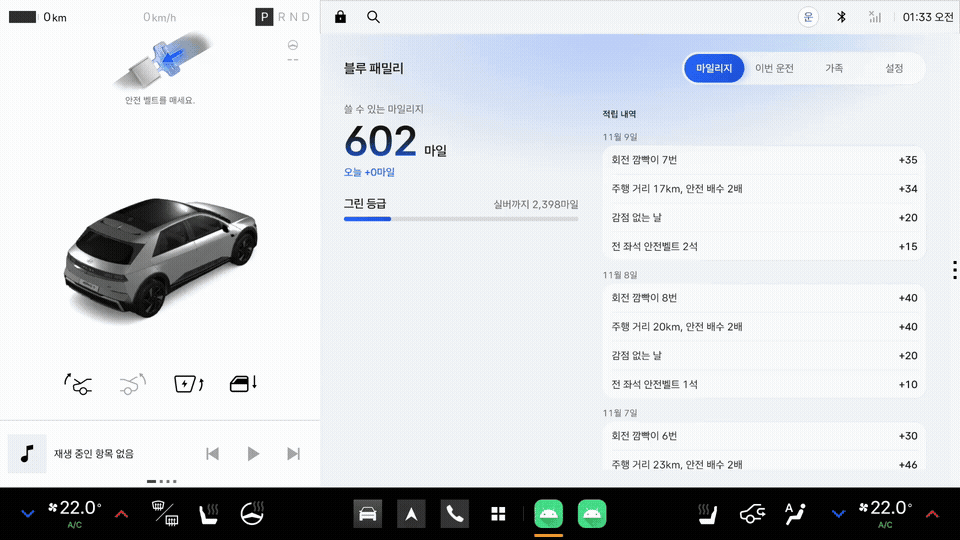
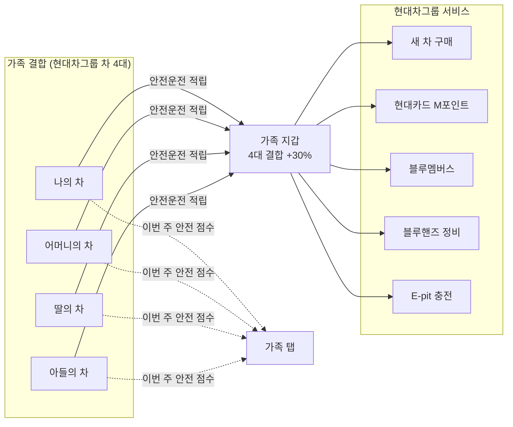
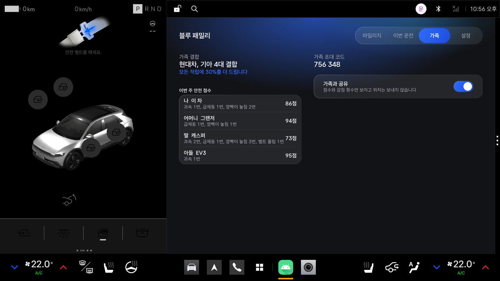
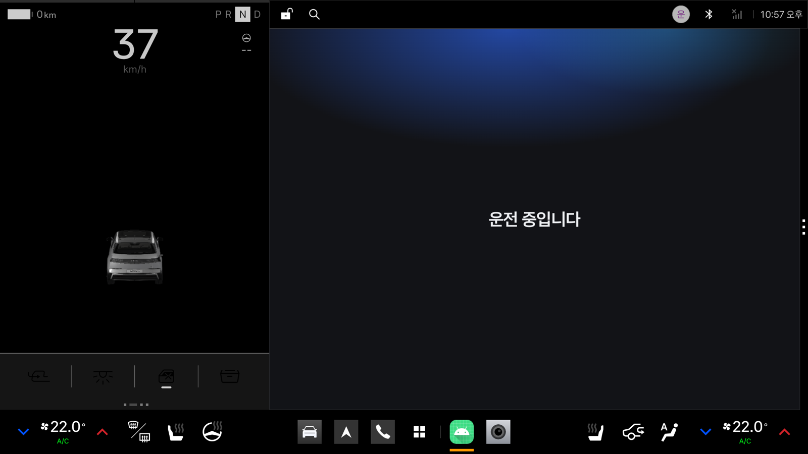
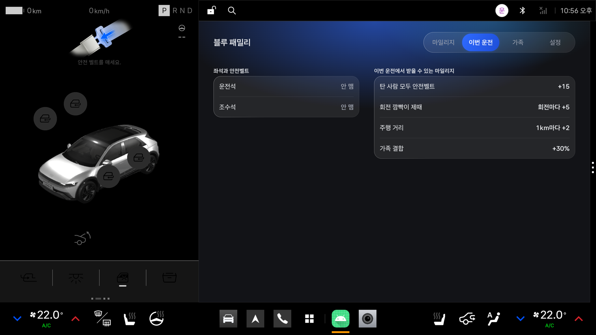
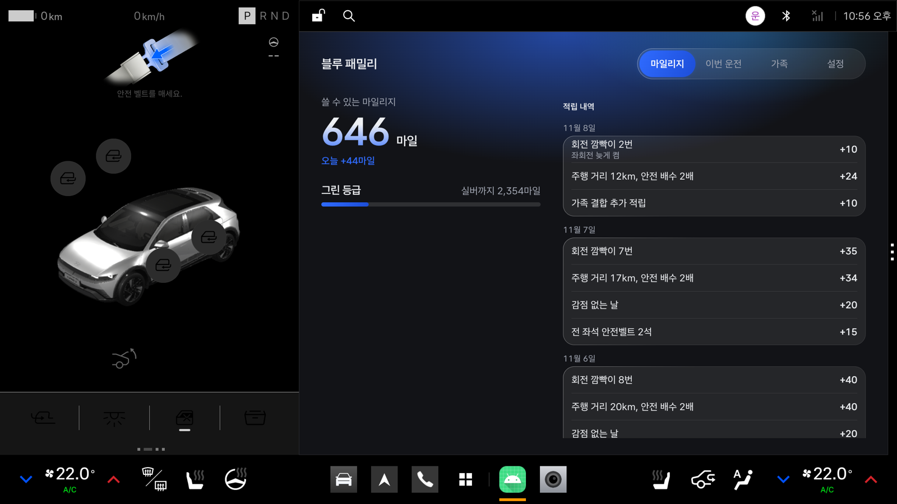
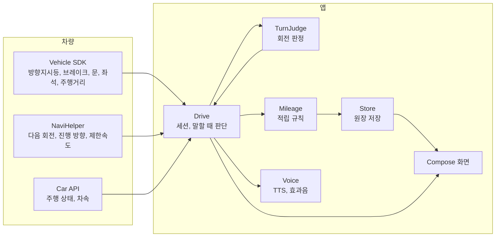

<div align="center">

# 블루 패밀리

**통신사처럼, 자동차도 가족결합**

가족이 안전하게 운전한 만큼 함께 쌓고, 현대차그룹 차를 더 많이 결합할수록 더 크게 쌓는 마일리지

현대차그룹 차량용 앱 개발 공모전 출품작


[APK 받기](apk/KoreaMobilityLabs_블루패밀리_release.apk) | [시연 영상](.github/readme/demo.mp4) | [설치와 실행](#설치와-실행) | [시연 순서](#시연-순서)

<br>



</div>

## 요약

블루 패밀리는 현대차그룹의 첫 가족결합 서비스를 차 안에서 시작하는 Pleos Connect 앱입니다. 가족이 각자 차에서 방향지시등을 제때 켜고 전 좌석 안전벨트를 매면 가족 지갑 하나에 마일리지가 쌓입니다. 결합한 현대차그룹 차가 늘수록 모든 적립에 최대 30%가 더 붙습니다. 가족은 서로의 이번 주 안전 점수를 보며 초보 운전 자녀와 부모님의 운전을 함께 챙깁니다.

| 항목 | 내용 |
|---|---|
| 사용자 | 현대차그룹 차를 타는 가족. 초보 운전 자녀와 고령 부모님이 있는 가족 |
| 판정 | 방향지시등, 전 좌석 안전벨트, 과속, 급제동 |
| 결합 혜택 | 결합 차량 2대 10%, 3대 20%, 4대 이상 30% 추가 적립 |
| 사용처 | 새 차 구매, 현대카드 M포인트, 블루멤버스, 블루핸즈, E-pit (제휴 협의 전) |
| 사용 SDK | Pleos Vehicle, NaviHelper, TextToSpeech, AAOS Car API |

## 문제 정의

블루 패밀리는 가족 쪽의 문제 하나와 현대차그룹 쪽의 문제 하나를 함께 풉니다.

### 가족: 서로의 운전이 걱정되지만, 어떻게 운전하는지 알 수 없습니다

2024년 국내 교통사고의 21.6%는 65세 이상 운전자가 냈습니다. 통계를 낸 2005년 이후 가장 높은 비율입니다. 경찰서 민원실에는 "아버지 면허 좀 거둬 달라"는 자녀들의 상담이 이어지지만, 고령 운전자의 면허 반납률은 몇 년째 2%대에 머물러 있습니다. 운전을 막 시작한 자녀도 걱정입니다. 초보 운전자의 사고율은 경력 운전자의 2.1배이고, 운전 첫해가 가장 위험합니다.

그런데 가족이 서로의 운전을 알 방법은 옆자리에 타 보는 것뿐입니다. 그래서 부모님께는 "그냥 계속 운전하시기"와 "면허 반납" 두 가지밖에 남지 않고, 초보 자녀에게는 "조심해라"라는 말밖에 할 수 없습니다. 둘 사이에서 가족이 운전을 지켜보며 함께 고쳐 갈 방법이 없습니다.

### 현대차그룹: 가족을 하나의 고객으로 묶을 방법이 없습니다

통신사는 가족의 휴대폰 회선에 인터넷과 IPTV까지 하나로 묶습니다. 많이 묶을수록 할인이 커져서, 한 사람만 다른 통신사로 옮기기 어렵습니다. 한 가족은 휴대폰처럼 차도 여러 대 타지만, 자동차에는 이런 결합이 없습니다. 현대차그룹의 포인트는 차를 사고 고칠 때만 쌓이고, 가족이 현대차그룹 차를 몇 대 타든 혜택은 같습니다. 2026년에 나온 블루멤버스 패밀리 멤버십도 가족이 포인트를 나눠 쓰게 할 뿐입니다.

고객을 붙잡는 방법은 이미 나와 있습니다. 티맵은 운전점수로 보험료를 깎아 주고, 할인을 한 번 받은 사람의 98%가 다시 가입합니다. 매일 하는 운전을 보상하면 고객이 남습니다. 하지만 지금 그 보상을 주는 곳은 차를 만든 회사가 아니라 휴대폰 앱과 보험사입니다.

## 결합 생태계

블루 패밀리는 두 문제를 결합 하나로 풉니다. 가족이 현대차그룹 차를 결합하면 서로의 안전 점수를 보고, 안전하게 운전할수록 가족 지갑에 마일리지가 쌓이고, 결합한 차가 많을수록 더 쌓입니다. 가족은 걱정을 덜고, 현대차그룹은 가족 전체를 고객으로 얻습니다.

이 구조가 작동하는 이유는 네 단계입니다.

| 단계 | 근거 |
|---|---|
| 1. 가족이 볼 수 있으면 운전이 바뀝니다 | 부모의 위험운전이 잦을수록 자녀도 잦고, 운전 기록을 가족에게 보여 주면 위험운전이 줄었습니다 (166가구, 12개월) |
| 2. 운전을 보상하면 계속 씁니다 | 티맵 안전운전 할인을 한 번 받은 사람의 98%가 다시 가입합니다 |
| 3. 가족이 묶이면 떠나기 어렵습니다 | 통신사 가족결합처럼, 한 사람이 떠나면 가족 지갑의 결합 추가 적립이 함께 줄어듭니다 |
| 4. 브랜드를 바꿔도 현대차그룹 안에 남습니다 | 현대차를 사려던 사람의 14%가 기아를 삽니다. 마일리지는 사람에게 쌓여서 브랜드를 바꿔도 이어집니다 |

| | 통신사 가족결합 | 블루 패밀리 |
|---|---|---|
| 묶는 것 | 가족의 휴대폰 회선 | 가족의 현대차그룹 차 |
| 함께 묶는 서비스 | 인터넷, IPTV | 현대카드, 블루멤버스, 블루핸즈, E-pit, 새 차 구매 |
| 혜택이 커지는 조건 | 결합 회선 수, 가입 기간 | 결합 차량 수, 안전운전 |
| 떠나기 어려운 이유 | 가족 모두의 할인이 함께 사라짐 | 가족 지갑의 마일리지와 결합 추가 적립이 함께 사라짐 |



| 문제 | 블루 패밀리 |
|---|---|
| 부모님과 자녀가 어떻게 운전하는지 모름 | 가족 탭에서 가족별 이번 주 안전 점수와 감점 항목(과속, 급제동, 방향지시등 놓침, 벨트 풀림)을 봅니다 |
| 걱정해도 할 수 있는 말이 없음 | 한 사람이 안전하게 운전할수록 가족 지갑이 함께 늘어서, 잔소리 대신 같이 점수를 올리자고 말할 수 있습니다 |
| 운전을 보상하는 곳이 휴대폰 앱과 보험사뿐 | 차 안에서 안전하게 운전하면 바로 현대차그룹 마일리지가 쌓입니다. 휴대폰 앱이 모르는 방향지시등과 좌석별 안전벨트까지 차 신호로 판정합니다 |
| 가족이 몇 대를 타든 혜택이 같음 | 결합 차량 2대 10%, 3대 20%, 4대 이상 30%를 모든 적립에 더합니다 |

가족에게는 점수와 감점 항목만 보내고, 위치, 경로, 감점 시각과 장소는 보내지 않습니다. 가족이 알 수 있는 것은 얼마나 안전하게 운전했는지뿐입니다. 사용처는 제휴 협의 전이라 앱 화면에는 두지 않았습니다.

| 근거 | 내용 | 출처 |
|---|---|---|
| 고령 운전자 사고 | 2024년 전체 교통사고의 21.6%(4만2,369건)가 65세 이상 운전자. 2005년 이후 최고 | [YTN 사이언스 2025-06-30](https://science.ytn.co.kr/program/view.php?mcd=0082&key=202506301605303480), 한국도로교통공단 통계 인용 |
| 면허 반납 | 고령 운전자 면허 반납률은 몇 년째 2%대. 자녀들의 면허 반납 상담이 이어짐 | [헤럴드경제 2024-01-19](https://biz.heraldcorp.com/article/3306899) |
| 초보 운전자 | 초보 운전자(2년 미만) 사고율은 경력 운전자의 2.1배, 운전 첫해가 가장 높음 (2015년 자료) | [뉴시스 2016-12-22](https://www.newsis.com/view/NISX20161222_0014597499), 현대해상 교통기후환경연구소 |
| 가족이 보는 운전 기록 | 부모의 위험운전이 잦을수록 자녀도 잦고, 기록을 가족에게 보여 주면 줄어듦 | [Taubman-Ben-Ari 외 2014](https://cris.iucc.ac.il/en/publications/the-contribution-of-parents-driving-behavior-family-climate-for-r/) |
| 운전 보상과 재가입 | 티맵 운전점수 이용자 1,600만 명, 안전운전 할인을 받은 이용자의 재가입률 98% (티맵모빌리티 발표) | [서울경제 2024-04-11](https://www.sedaily.com/article/13873095) |
| 현대차그룹 안의 이동 | 현대차 구매 의향자의 76%가 현대차, 14%가 기아를 삼 | [지디넷코리아, 컨슈머인사이트 조사 2026-05-29](https://v.daum.net/v/20260529143100988) |
| 블루멤버스 패밀리 멤버십 | 2026년 도입, 가족 최대 8명이 포인트를 실시간 공유 | [헤럴드경제 2026-04-30](https://www.heraldk.com/article/2026043018051757030) |

## 주요 기능

### 가족 탭



초대 코드로 결합하면 가족이 지갑 하나를 함께 씁니다. 결합 차량 수와 추가 적립 비율, 가족별 이번 주 안전 점수와 감점 항목을 보여 줍니다. 위치, 경로, 감점 시각과 장소는 가족에게 보내지 않습니다.

### 주행 중 화면



차가 달리기 시작하면 "운전 중입니다" 한 줄만 남기고 애니메이션을 끕니다. 판정은 계속 돌고, 결과는 정차한 뒤 음성과 화면으로 알립니다.

### 이번 운전 탭



사람이 앉은 좌석마다 안전벨트를 맸는지 보여 주고, 이번 운전에서 받을 수 있는 마일리지를 함께 보여 줍니다. 뒷좌석의 아이와 부모님까지 챙겨야 쌓입니다.

### 마일리지 탭



쓸 수 있는 마일리지, 그날 적립, 등급을 보여 줍니다. 정차하면 "회전 3번 중 2번 깜빡이를 제때 켰습니다. 44마일이 쌓였습니다"처럼 음성으로 알리고, 놓친 회전이 있으면 "좌회전은 30미터 전에 켜면 됩니다"를 덧붙입니다.

처음 실행하면 동의 화면에서 쓰는 정보를 보여 주고, "동의하고 시작"을 눌러야 판정을 시작합니다.

## 판정과 마일리지 규칙

| 판정 | 기준 | 신호 |
|---|---|---|
| 내비 안내 회전 | 회전 30m 전(고속도로 100m 전)에 같은 방향 방향지시등이 켜져 있음 | 방향지시등(Vehicle), 다음 회전과 거리(NaviHelper) |
| 내비 없는 회전 | 10초 안에 진행 방향이 60도 넘게 바뀌기 전 5초 안에 방향지시등을 켬 | 방향지시등(Vehicle), 진행 방향(NaviHelper) |
| 과속 | 제한속도보다 20km/h 넘게 3초 이상 | 차속(`PERF_VEHICLE_SPEED`), 제한속도(NaviHelper) |
| 급제동 | 브레이크를 밟은 채 초당 11km/h 넘게 감속 | 브레이크 페달(Vehicle), 차속 |
| 벨트 풀림 | 달리는 중에 사람이 앉은 좌석의 벨트가 풀림 | 좌석별 안전벨트, 좌석 착석(Vehicle Seat) |

| 적립 | 조건 | 마일 |
|---|---|---|
| 주행 거리 | 운전 한 번에 달린 거리. 최근 7일 방향지시등 준수율 95% 이상이면 2배 | 1km당 1 |
| 내비 안내 회전 | 방향지시등을 제때 켬 | 회당 5 |
| 내비 없는 회전 | 방향지시등을 제때 켬 | 회당 2 |
| 전 좌석 안전벨트 | 운전 내내 앉은 모든 좌석이 벨트를 맴 | 10, 동승 좌석당 5 추가 |
| 감점 없는 날 | 그날 마친 운전에 감점이 없음 | 하루 20 |
| 7일 연속 | 감점 없는 날이 7일 이어짐 | 100 |
| 가족 결합 | 결합 차량 2대 10%, 3대 20%, 4대 이상 30% | 그 운전의 적립에 더함 |

안전 점수는 매주 100점에서 시작해 과속 5점, 급제동 3점, 방향지시등 놓침 3점, 벨트 풀림 5점을 뺍니다. 감점은 마일리지를 깎지 않습니다. 하루 상한은 300마일이고 결합 추가 적립은 상한에 넣지 않습니다. 등급은 그린에서 시작해 실버(누적 3,000마일, 최근 30일 방향지시등 준수율 90% 이상), 골드(누적 10,000마일, 최근 90일 동안 운전한 날의 95% 이상이 감점 없는 날)로 오릅니다.

## 안전 설계

공모전이 안내한 Pleos 개발자 가이드의 주행 중 동작 기준에 맞췄습니다.

| 가이드 기준 | 구현 |
|---|---|
| 주행 중 1~2초 안에 파악, 애니메이션 금지 | `CarUxRestrictions`가 주행 중을 알리면 한 줄 화면으로 바꾸고 앱 전체의 애니메이션을 끕니다 |
| 운전에 필요한 안내만 | 정차 중이거나, 브레이크와 방향지시등이 꺼져 있고 다음 회전이 500m 넘게 남았을 때만 말합니다 |
| 오디오 포커스 | `GAIN_TRANSIENT_MAY_DUCK`으로 받아 내비 안내와 겹치지 않습니다 |
| 가독성과 조작 | 본문 대비 16.3:1, 누르는 영역 88dp 이상, 텍스트 입력 없음 |

## 설치와 실행

| 준비물 | 값 |
|---|---|
| 에뮬레이터 | Pleos Connect v2.1.0 (Android 14, API 34, 2560×1440) |
| APK | [`apk/KoreaMobilityLabs_블루패밀리_release.apk`](apk/KoreaMobilityLabs_블루패밀리_release.apk) |
| 차량 값 조작 | Pleos Connect Virtual Console (`http://127.0.0.1:8088/`) |

```bash
adb install -r apk/KoreaMobilityLabs_블루패밀리_release.apk
```

```bash
adb forward tcp:8088 tcp:8088
```

블루 패밀리를 열고 "동의하고 시작"을 누른 뒤 차속(위치 그룹) 권한을 허용합니다. 에뮬레이터 내비는 실제로 움직이지 않아서, 설정 탭에 회전 안내를 재생하는 시연 도구를 넣었습니다.

## 시연 순서

시작 전에 Virtual Console에서 충전구(Charge Port)를 닫고, 조수석 착석은 켜고 뒷좌석 착석은 꺼 둡니다.

| 순서 | 앱 | Virtual Console |
|---|---|---|
| 1 | 설정 탭에서 "지난 6일 기록 채우기" | Door Position: Close |
| 2 | 설정 탭에서 "회전 안내 재생" 시작 | |
| 3 | 주행 중 화면으로 바뀜 | Gear: N, 속도를 20~50km/h 사이에서 바꿔 가며 달림 |
| 4 | | 재생 5초에 Turn Signal: Blink right, 20초에 Off |
| 5 | | 재생 50초에 Blink left(늦게 켬), 53초에 Blink right |
| 6 | | 재생 66초에 Off, Odometer를 12km 올림 |
| 7 | | 브레이크를 떼고 속도를 0으로 줄인 뒤 BRAKE, Gear: P |
| 8 | 요약 음성과 함께 마일리지가 오름. 이번 운전, 가족 탭 확인 | Door Position: Open |

기어를 D로 넣으면 에뮬레이터가 내비를 앞으로 띄워서 N으로 시연합니다. 주행거리계는 입력된 값보다 큰 값만 받습니다. Virtual Console에는 벨트를 매는 조작이 없어 모든 좌석이 "안 맴"으로 보입니다.

## 기술 스택

| 영역 | 사용 |
|---|---|
| 언어, UI | Kotlin 2.2, Jetpack Compose (BOM 2026.09.00) |
| 차량 | Pleos Vehicle 2.3.2, AAOS Car API (`CarUxRestrictionsManager`, `CarPropertyManager`) |
| 내비 | Pleos NaviHelper 3.0.5 |
| 음성 | Pleos TextToSpeech 3.3.1 (ON_DEVICE, 네트워크 불필요) |
| 저장 | `AtomicFile` JSON, `SharedPreferences` |
| 빌드 | AGP 9.4, minSdk 28, targetSdk 37 |

<details>
<summary>구조</summary>



</details>

## 앞으로

- 가족 결합 서버. 지금은 기기 안에만 저장하고, 다른 가족의 점수는 예시입니다
- 현대카드, 블루멤버스, 블루핸즈, E-pit, 보험사와 제휴 협의
- 실제 내비 경로로 회전 판정과 과속 판정 정확도 측정
