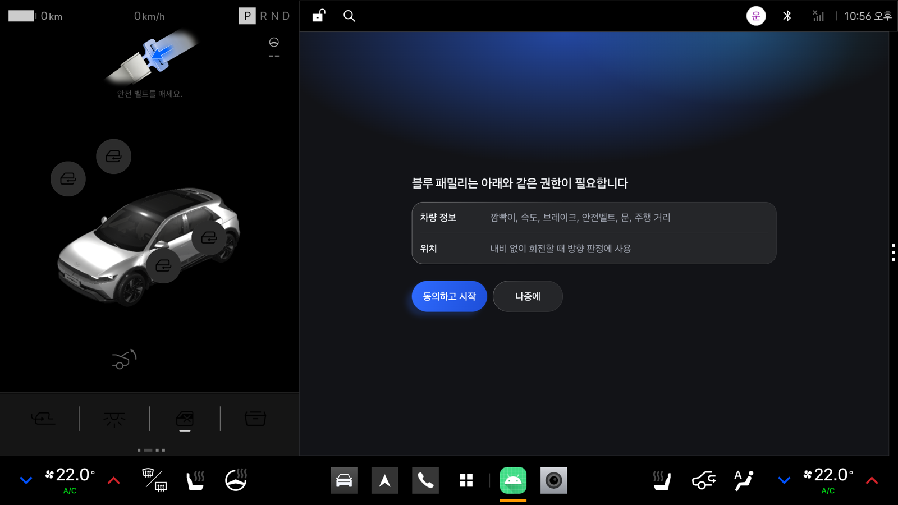
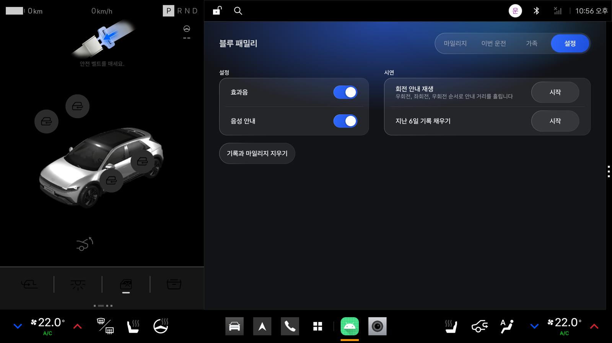
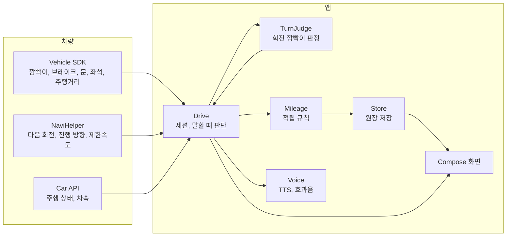

<div align="center">

# 블루 패밀리

**현대차그룹 생태계의 첫 가족결합, 안전운전 마일리지**

가족이 안전하게 운전한 만큼 함께 쌓고, 가족이 현대차와 기아를 더 많이 탈수록 더 크게 쌓입니다.

현대차와 기아의 Pleos Connect 차량용 앱 | 현대차그룹 차량용 앱 개발 공모전 출품작


[APK 받기](apk/Drivoice_블루패밀리_release.apk) | [시연 영상](.github/readme/demo.mp4) | [설치와 실행](#설치와-실행) | [시연 순서](#시연-순서)

<br>


<sub>Pleos Connect 에뮬레이터 v2.1.0에서 녹화했습니다. 출발 7초와 정차 뒤 24초를 이어 붙였습니다.</sub>

</div>

<br>

## 요약

블루 패밀리는 통신사의 가족결합을 자동차에 옮긴 Pleos Connect 앱입니다. 이름은 블루멤버스, 블루링크, 블루핸즈로 이어지는 현대차그룹의 '블루' 서비스 줄기에 가족을 더한다는 뜻입니다. 탄 사람 모두 안전벨트를 매고, 깜빡이를 제때 켜고, 과속과 급제동 없이 달리면 가족 지갑에 마일리지가 쌓입니다. 가족이 결합한 현대차, 기아 차가 한 대 늘 때마다 모든 적립에 10%가 더 붙고(최대 30%), 쌓인 마일리지는 다음 차 값, 현대카드 M포인트, 블루멤버스, 블루핸즈, E-pit 충전에 씁니다.

가족은 서로의 이번 주 안전 점수와 감점 횟수를 봅니다. 위치와 경로, 언제 어디서 감점됐는지는 차 밖으로 나가지 않습니다.

| 항목 | 내용 |
|---|---|
| 사용자 | 현대차, 기아를 타는 가족. 초보부터 장년까지 운전자 전원 |
| 적립 | 전 좌석 안전벨트, 회전 깜빡이, 주행 거리, 감점 없는 날, 가족 결합 추가 적립 |
| 감점 | 과속, 급제동, 깜빡이 놓침, 주행 중 벨트 풀림. 주간 100점에서 깎고, 감점이 하나라도 있는 날은 감점 없는 날 적립을 받지 못합니다 |
| 화면 | 탭 4개(마일리지, 이번 운전, 가족, 설정)와 동의, 주행 중 화면 |
| 쓰는 곳 | 다음 차 구매, 현대카드 M포인트, 블루멤버스, 블루핸즈 정비, E-pit 충전, 보험 특약 (제휴 협의 전, 앱 화면에는 두지 않음) |
| 사용 SDK | Pleos Vehicle, NaviHelper, TextToSpeech, AAOS Car API |
| 저장 | 기기 안 파일 하나. 서버 없이 동작합니다. 다른 가족의 점수는 서버를 잇기 전이라 예시입니다 |
| 검증 | 단위 테스트 25건 통과, 에뮬레이터에서 회전 판정, 좌석 착석, 결합 추가 적립까지 확인 |

<br>

## 문제 정의

자동차 경쟁은 한 대를 잘 만드는 경쟁에서 고객을 생태계에 묶어 두는 경쟁으로 바뀌었습니다. 현대차그룹은 멤버십, 카드, 정비망, 충전망을 모두 갖고 있지만, 이 자산은 차를 사거나 고칠 때만 작동합니다. 고객이 가장 오래 머무는 운전 시간과, 한 가족 안의 여러 대의 차를 잇는 고리가 없습니다.

| 항목 | 값 | 출처 |
|---|---|---|
| 2026년 9월 국내 차종 판매 1위 | 테슬라 모델Y 11,421대. 그랜저 8,898대, 쏘렌토 6,957대 | [겟차, 산업통상부 9월 자동차산업 동향 인용](https://web.getcha.kr/blog/tesla-model-y-sales-first-place) |
| 2026년 1~9월 누적 | 쏘렌토 74,933대, 모델Y 73,123대. 차이 1,810대 | 같은 자료 |
| 2026년 8월 테슬라 수입차 점유율 | 34.9%. 2월부터 7개월 연속 수입 브랜드 1위 | [헤럴드경제 2026-09-02](https://www.heraldk.com/article/2026090220504410941) |
| 2025년 국내 전기차 판매 | 기아 60,609대, 테슬라 59,893대, 현대차 55,461대 | [뉴스와 2026-02-19](https://www.news-wa.com/article/automobiles/new-car/2026/02/19/20260219500065) |
| 블루멤버스 패밀리 멤버십 | 2026년 도입. 가족 최대 8명이 포인트를 실시간 공유 | [헤럴드경제 2026-04-30](https://www.heraldk.com/article/2026043018051757030) |
| 위험운전과 사고 | 사고 운전자가 무사고 운전자보다 위험운전 약 1.5배 | [정책브리핑 2022-05-20](https://www.korea.kr/news/policyNewsView.do?newsId=148901825) |
| 부모와 자녀의 운전 | 자녀의 위험운전 빈도는 부모의 빈도와 함께 움직이고, 기록을 가족에게 돌려주면 줄어듦 (166가구, 12개월) | [Taubman-Ben-Ari 외 2014](https://cris.iucc.ac.il/en/publications/the-contribution-of-parents-driving-behavior-family-climate-for-r/) |

블루 패밀리는 그 고리를 운전석 안에 만듭니다. 결합 혜택의 조건을 요금이 아니라 안전 운전에 두기 때문에, 가족이 포인트를 더 모으려 할수록 가족 모두의 운전이 안전해집니다.

<br>

## 주요 기능

### 주행 중에는 한 줄만


차가 달리기 시작하면 화면은 "운전 중입니다" 한 줄로 바뀌고 모든 움직임이 멈춥니다. 버튼, 숫자, 목록은 보이지 않습니다. 운전자가 화면을 볼 이유를 만들지 않는 것이 이 화면의 목적입니다. 판정은 화면과 상관없이 앱 전체에서 계속 돌아가고, 결과는 멈춘 뒤에 음성과 화면으로 알려 줍니다.

### 회전 깜빡이 판정

내비가 알려 주는 다음 회전까지의 거리와 깜빡이 상태를 함께 봅니다. 일반 도로는 회전 30m 전, 고속도로(제한속도 80km/h 이상)는 100m 전에 같은 방향 깜빡이가 켜져 있으면 "제때 켬"으로 기록합니다. 내비 안내 없이 달릴 때는 10초 안에 진행 방향이 60도 넘게 바뀌면 회전으로 보고, 그 직전 5초 동안의 깜빡이를 확인합니다.

| 경우 | 기준 | 마일 |
|---|---|---|
| 내비 안내 회전 | 일반 도로 30m 전, 고속도로 100m 전에 깜빡이 켬 | 5 |
| 내비 없는 회전 | 진행 방향 60도 변화 전 5초 안에 깜빡이 켬 | 2 |
| 늦게 켜거나 안 켬 | 안전 점수에서 3점 빼고, 그날은 감점 없는 날이 되지 못함 | 0 |

### 과속과 급제동 감점

안전 점수는 주간 100점에서 시작해 위험한 행동마다 깎습니다. 감점이 하나라도 있으면 그날의 "감점 없는 날" 20마일을 받지 못합니다. 이미 쌓인 마일리지는 깎지 않습니다.

| 항목 | 판정 기준 | 감점 | 신호 |
|---|---|---|---|
| 과속 | 제한속도보다 20km/h 넘게 3초 이상. 넘은 구간 하나를 1번으로 셈 | 5 | 차속(`PERF_VEHICLE_SPEED`), 제한속도(NaviHelper) |
| 급제동 | 브레이크를 밟은 채 초당 11km/h 넘게 감속 | 3 | 브레이크 페달(Vehicle), 차속 |
| 깜빡이 놓침 | 회전 전에 켜지 않음 | 3 | 방향지시등(Vehicle), 회전 안내(NaviHelper) |
| 벨트 풀림 | 달리는 중에 사람이 앉은 좌석의 벨트가 풀림 | 5 | 좌석별 안전벨트, 좌석 착석(Vehicle Seat) |

깜빡이 없는 차로 변경은 Pleos SDK가 차선 정보를 주지 않아 아직 판정하지 않습니다.

### 이번 운전: 좌석별 안전벨트와 받을 수 있는 마일리지


출발 직전에 운전자가 할 수 있는 일은 "탄 사람 모두 벨트 매기" 하나입니다. 이번 운전 탭은 그 행동과 보상을 한 화면에 붙입니다. 왼쪽에는 사람이 앉은 좌석만 골라 벨트를 맸는지 실시간으로 보여 주고, 오른쪽에는 지금 탄 사람 수와 오늘 기록으로 이번 운전에서 받을 수 있는 마일리지를 보여 줍니다. 감점 없는 날 20마일은 오늘 아직 감점이 없을 때만 보입니다.

운전 한 번 내내 앉은 모든 좌석이 벨트를 매고 있으면 10마일, 동승자가 있으면 좌석당 5마일을 더 줍니다. 깜빡이와 과속이 운전자 한 사람의 습관이라면, 안전벨트는 뒷좌석의 아이와 부모님까지 함께 챙겨야 쌓입니다. 출발할 때부터 벨트를 매지 않은 좌석이 있으면 이 적립만 받지 못하고, 달리던 중에 벨트를 풀어야 감점됩니다.

차가 탑승을 감지하지 못하는 좌석은 값이 오지 않아 목록에서 빠집니다. 그 좌석은 적립도 감점도 하지 않아서, 감지 못 한 좌석 때문에 틀린 감점이 생기지 않습니다. Pleos Vehicle SDK 2.3.2는 표준 착석 값 1(빈자리)을 `true`로 넘겨서, 앱에서 뒤집어 씁니다. Virtual Console에는 벨트를 매는 조작이 없어 에뮬레이터에서는 모든 좌석이 "안 맴"으로 보입니다.

### 마일리지 원장과 등급


앱을 열거나 운전을 마치고 돌아오면 마일리지 탭이 먼저 보입니다. 쓸 수 있는 마일리지가 0부터 자릿수별로 올라가고, 그 아래 오늘 쌓인 마일리지가 나옵니다. 정차 후에는 음성으로 "회전 3번 중 2번 깜빡이를 제때 켰습니다. 44마일이 쌓였습니다"처럼 짧게 알려 주고, 놓친 회전이 있으면 "좌회전은 30미터 전에 켜면 됩니다" 한 줄만 덧붙입니다.

적립 내역은 날짜별로 묶어 보여 주고, 회전 깜빡이 줄 아래에는 그 운전에서 늦게 켠 회전만 작게 적습니다. 등급은 그린, 실버, 골드 세 단계이고, 다음 등급까지 남은 마일을 막대로 보여 줍니다. 같은 운전이 두 번 적립되지 않도록 거래마다 고유 번호를 붙입니다.

### 마일리지를 쓰는 곳

마일리지는 차를 사고, 고치고, 충전하고, 보험에 드는 곳에서 쓰는 것을 목표로 합니다(제휴 협의 전). 앱 화면에는 사용처 탭을 두지 않았습니다.

| 사용처 | 쓰는 방식 |
|---|---|
| 다음 차 구매 | 현대차, 기아 새 차를 살 때 차 값에서 현금처럼 뺍니다 |
| 현대카드 M포인트 연동 | 운전 마일리지를 M포인트로 옮겨 카드 포인트와 합칩니다 |
| 블루멤버스 포인트 전환 | 블루멤버스 패밀리 멤버십 포인트로 바꿉니다 |
| 블루핸즈 정비 | 정비 결제 때 뺍니다 |
| E-pit 충전 | 전기차 충전 요금에서 뺍니다 |
| 보험 안전 운전 특약 | 안전 점수를 특약 할인 근거로 냅니다 |

마일리지는 차가 아니라 사람에게 쌓입니다. 차를 바꿔도 현대차나 기아 차를 고르면 마일리지와 등급이 그대로 이어집니다.

### 가족 지갑


가족 초대 코드로 결합하면 마일리지 지갑을 함께 씁니다. 왼쪽에는 결합 차량 수와 추가 적립률, 가족별 이번 주 안전 점수와 감점 내용이 나옵니다. 감점이 있는 항목만 적고, 없으면 "감점 없음"이라고 적습니다. 위치, 경로, 언제 어디서 감점됐는지는 가족에게 보내지 않습니다. 공유를 끄면 결합 추가 적립도 멈춥니다. 다른 가족 3명의 점수는 서버를 잇기 전이라 예시입니다.

### 동의와 설정

| 동의 | 설정 |
|---|---|
|  |  |
| 처음 실행하면 어떤 정보를 어디에 쓰는지 두 줄로 보여 줍니다. "동의하고 시작"을 눌러야만 판정을 시작합니다. | 효과음과 음성 안내를 끌 수 있고, 기록과 마일리지를 두 번 확인한 뒤 지웁니다. 오른쪽의 시연 도구로 회전 안내를 재생하고 지난 6일 기록을 채웁니다. |

<br>

## 마일리지 규칙

| 항목 | 조건 | 마일 |
|---|---|---|
| 주행 거리 | 운전 한 번에 달린 거리 | 1km당 1 |
| 안전 배수 | 최근 7일 깜빡이 준수율 95% 이상 | 주행 거리 마일 2배 |
| 회전 깜빡이 | 내비 안내 회전에서 제때 켬 | 회당 5 |
| 내비 없는 회전 | 진행 방향 변화 전에 켬 | 회당 2 |
| 전 좌석 안전벨트 | 운전 내내 앉은 모든 좌석이 벨트를 맴 | 10, 동승 좌석당 5 |
| 감점 없는 날 | 그날 운전에 과속, 급제동, 깜빡이 놓침, 벨트 풀림이 하나도 없음 | 하루 20 |
| 7일 연속 | 감점 없는 날이 7일 이어짐 | 100 |
| 가족 결합 | 결합 차량 2대 10%, 3대 20%, 4대 이상 30% | 그 운전 적립에 더함 |

하루 상한은 300마일이고 가족 결합 추가분은 상한에서 뺍니다. 실버는 누적 3,000마일과 최근 30일 깜빡이 준수율 90% 이상, 골드는 누적 10,000마일과 최근 90일 동안 운전한 날의 95% 이상이 감점 없는 날이어야 합니다.

<br>

## 안전 설계

공모전이 안내한 Pleos 개발자 가이드의 주행 중 동작 기준을 먼저 정하고 화면을 그렸습니다. 아래 표의 왼쪽은 가이드 기준, 오른쪽은 이 앱이 지키는 방식입니다.

| 가이드 기준 | 구현 |
|---|---|
| 주행 중 1~2초 안에 파악, 애니메이션 금지 | `CarUxRestrictions`가 주행 중을 알리면 전환 효과 없이 한 줄 화면으로 바꾸고, 앱 전체의 모션을 끕니다 |
| 운전에 필요한 안내만 | 말할 때 판단: 정차(차속 0.5m/s 미만) 중이거나, 브레이크와 깜빡이가 꺼져 있고 다음 회전이 500m 넘게 남았을 때만 말합니다. 미룬 안내는 2분이 지나면 버립니다 |
| 오디오 포커스 | 음성과 효과음 모두 `GAIN_TRANSIENT_MAY_DUCK`으로 포커스를 받아 내비 안내와 겹치지 않게 합니다 |
| 텍스트 입력 없음 | 주행 중에는 입력을 받지 않고, 정차 후에도 스위치와 버튼만 씁니다 |
| 대비 4.5:1 이상 | 어두운 테마 기준 본문 16.3:1, 보조 글자 7.8:1, 파란 버튼 위 흰 글자 4.5:1 이상. 파란 강조 글자(4.1:1)는 24sp 이상 큰 글자에만 씁니다 |
| 한 손 조작 | 누르는 영역은 모두 88dp 이상입니다 |
| CCP 미지원 선언, Back은 `moveTaskToBack` | 매니페스트에 `ROTARY_SUPPORTED=false`를 선언했고, 최상위 화면에서 뒤로 가기는 앱을 닫지 않고 뒤로 보냅니다 |
| 위치 사용은 명시적 동의 | "동의하고 시작" 버튼으로만 동의하고, 위치는 내비 없이 회전할 때 진행 방향 판정에만 씁니다. 마이크는 쓰지 않습니다 |

<br>

## 디자인과 모션

차곡과 같은 디자인을 씁니다. 어두운 바탕 위에 파란 빛 하나만 쓰고(`ui/Theme.kt`), 이름의 '블루'와 색을 맞췄습니다. 화면 위쪽에는 파란 불빛이 은은하게 번지고, 탭과 버튼과 목록은 반투명 유리 판 위에 올립니다. 유리 판은 왼쪽 위 테두리가 빛을 받은 듯 밝고, 아래로 갈수록 옅어집니다. 고른 탭, 켠 스위치, 주 버튼은 밝은 파랑에서 짙은 파랑으로 흐르는 빛으로 칠하고 같은 색 그림자로 번지게 합니다.

유리는 조작부와 목록 판에만 쓰고 유리 위에 유리를 겹치지 않습니다. 움직임은 눌렀다는 것과 무엇이 어디로 갔는지를 알릴 때만 쓰고, 화면 불빛은 움직이지 않습니다.

| 토큰 | 밝은 테마 | 어두운 테마 |
|---|---|---|
| 배경 | `#F4F5F9` | `#121317` |
| 유리 판 | 흰색 70% | 흰색 8% |
| 본문 | `#16171B` | `#EEF0F3` |
| 보조 글자 | `#5B5F6B` | `#A3A8B4` |
| 강조 빛 | `#2F6BFF` → `#1D4ED8` | 같음 |

글자 크기는 1~2초 안에 읽히도록 차량용(본문 28sp)으로 키웠습니다. 파란색은 누를 곳(탭, 버튼, 스위치)과 화면마다 하나인 핵심 숫자(잔액, 오늘 적립, 결합 추가 적립률), 좋은 상태(벨트 맴)에만 씁니다. 앱 이름과 목록 숫자는 흰 글자입니다. 한국어는 낱말 단위로 줄을 바꿉니다.

| 모션 | 쓰는 곳 |
|---|---|
| 스프링 눌림 | 버튼과 탭을 누르면 95%로 살짝 눌렸다가 튕기며 돌아옵니다. 짧은 진동도 함께 줍니다 |
| 손끝 불빛 | 누른 자리에서 빛이 번졌다가 손을 떼면 0.3초 동안 사라집니다 |
| 미끄러지는 선택 알약 | 탭을 바꾸면 파란 알약이 스프링으로 옮겨 갑니다. 스위치 손잡이도 같습니다 |
| 자릿수별로 굴러가는 숫자 | 오늘 쌓인 마일리지, 잔액. 자리마다 40ms씩 늦게 출발합니다 |
| 순차 등장 | 탭을 열면 항목이 40ms 간격으로 위에서부터 나타납니다 |
| 즉시 정지 | 주행 중이 되면 진행 중인 모션도 바로 끝 상태로 바뀌고, 눌림 크기 변화도 멈춥니다 |

<br>

## 설치와 실행

### 준비물

| 항목 | 값 |
|---|---|
| 에뮬레이터 | Pleos Connect v2.1.0 (Android 14, API 34, 2560×1440) |
| APK | [`apk/Drivoice_블루패밀리_release.apk`](apk/Drivoice_블루패밀리_release.apk) (release 빌드, 40MB). [Releases](https://github.com/wjdtkdgns777/blue-family-private/releases/latest)에도 같은 파일이 있습니다 |
| 차량 값 조작 | Pleos Connect Virtual Console (`http://127.0.0.1:8088/`) |

### APK 설치

```bash
adb install -r apk/Drivoice_블루패밀리_release.apk
```

```bash
adb forward tcp:8088 tcp:8088
```

앱 서랍에서 블루 패밀리를 열고 "동의하고 시작"을 누릅니다. 이어서 뜨는 차속(위치 그룹) 권한을 허용합니다. 차량 전용 앱(`android.hardware.type.automotive`)이라 휴대폰 에뮬레이터에는 설치되지 않습니다.

제출한 APK는 release 빌드입니다. 에뮬레이터 내비는 실제로 움직이지 않습니다. 그래서 회전 안내를 재생하는 시연 도구를 release 빌드의 설정 탭에도 넣었습니다. 서명은 Android 기본 디버그 키로 했습니다.

### 직접 빌드

```bash
./gradlew :app:assembleRelease
```

```bash
./gradlew :app:testDebugUnitTest
```

Pleos SDK는 `https://nexus-playground.pleos.ai/repository/maven-releases/`에서 받습니다. JDK는 Android Studio에 들어 있는 JBR을 씁니다(`JAVA_HOME` 지정).

<br>

## 시연 순서

아래 순서로 위 GIF와 같은 화면을 볼 수 있습니다. 시작 전에 Virtual Console에서 충전구(Charge Port)를 닫고, 조수석 착석을 켜고 뒷좌석 착석은 꺼 둡니다.

| 순서 | 앱 | Virtual Console |
|---|---|---|
| 1 | 설정 탭에서 "지난 6일 기록 채우기" | Door Position: Close |
| 2 | 설정 탭에서 "회전 안내 재생" 시작 | |
| 3 | 주행 중 화면으로 바뀜 | Gear: N, 속도를 20~50km/h 사이에서 바꿔 가며 달림. D로 넣으면 에뮬레이터가 내비를 앞으로 띄워서 N으로 시연합니다 |
| 4 | | 재생 5초에 Turn Signal: Blink right, 20초에 Off |
| 5 | | 재생 50초에 Blink left(늦게 켬), 53초에 Blink right |
| 6 | | 재생 66초에 Off, Odometer를 12km 올림 |
| 7 | | 브레이크를 떼고 속도를 0으로 줄인 뒤 BRAKE, Gear: P |
| 8 | 요약 음성과 함께 마일리지가 오름. 이번 운전, 가족 탭 확인 | Door Position: Open |

주행거리계는 앞으로만 움직입니다. 지금 값보다 큰 값을 넣어야 합니다. 에뮬레이터 속도는 계단처럼 바뀌어서, 브레이크를 밟은 채 속도를 내리면 급제동으로 잡힙니다.

<br>

## 구조



| 파일 | 하는 일 |
|---|---|
| `Drive.kt` | 차량 리스너를 모아 운전 한 번(세션)을 열고 닫습니다. 과속, 급제동, 좌석별 안전벨트, 말할 때 판단을 다룹니다 |
| `TurnJudge.kt` | 내비 안내 회전과 내비 없는 회전을 판정합니다 |
| `Mileage.kt` | 운전 한 번이 끝나면 적립 거래를 만들고 하루 상한과 중복을 정리합니다 |
| `Store.kt` | 원장을 `AtomicFile`로 저장합니다. 진행 중인 운전도 바뀔 때마다 저장해서, 앱이 꺼져도 다음 실행 때 정산합니다 |
| `Voice.kt` | 기기 안(ON_DEVICE) TTS, 효과음, 오디오 포커스를 다룹니다 |
| `ui/` | 화면 6개와 디자인 토큰, 공통 컴포넌트 |

<br>

## 기술 스택

| 영역 | 사용 |
|---|---|
| 언어, UI | Kotlin 2.2, Jetpack Compose (BOM 2026.09.00) |
| 차량 | Pleos Vehicle 2.3.2, AAOS Car API (`CarUxRestrictionsManager`, `CarPropertyManager`) |
| 내비 | Pleos NaviHelper 3.0.5 |
| 음성 | Pleos TextToSpeech 3.3.1 (ON_DEVICE, 네트워크 불필요) |
| 저장 | `AtomicFile` JSON, `SharedPreferences` |
| 빌드 | AGP 9.4, minSdk 28, targetSdk 37 |

<br>

## 검증 결과

| 항목 | 결과 |
|---|---|
| 단위 테스트 | 25건 통과. 내비 회전 판정 7건, 내비 없는 회전 4건, 마일리지, 감점 없는 날, 결합, 점수, 안전벨트 13건, 기본 1건 |
| 에뮬레이터 주행 | 회전 3번 중 2번 제때 켬, 주행 12km. 오늘 +44마일(회전 10, 거리 24, 결합 추가 10). 좌회전을 늦게 켜서 감점 없는 날은 받지 못함 |
| 좌석 | 조수석, 뒷좌석 착석을 켜고 끄면 이번 운전 탭의 좌석 목록과 벨트 적립 미리보기가 바로 바뀜 |
| 음성 | 정차 후 요약 음성 (11월 1일 확인) |
| 저장 | 원장 파일이 깨지면 따로 보관하고 빈 상태로 시작. 없어진 적립 종류로 저장된 줄은 건너뜀. 진행 중인 운전은 다음 실행 때 정산 |

<sub>2026-11-08, Pleos Connect 에뮬레이터 v2.1.0에서 release 빌드로 확인했습니다. 마일 수치는 설정 탭의 "지난 6일 기록 채우기"를 쓴 결과입니다.</sub>

<details>
<summary>미검증 항목</summary>

| 항목 | 이유 |
|---|---|
| 실제 경로 위 회전 안내 갱신 주기, 진행 방향 | 에뮬레이터에서 `geo fix`, NMEA, Virtual Console 가속 모두 내비 위치를 움직이지 못했습니다 |
| 안전벨트 적립과 벨트 풀림 감점 | Virtual Console에 벨트를 매는 조작이 없습니다 |
| 과속 | 제한속도는 실제 내비 경로가 있어야 들어옵니다 |
| 실차의 뒷좌석 착석 감지 | 차종마다 지원이 다릅니다 |
| 세로 창, TalkBack, CPU 사용량 | 확인하지 않았습니다 |

</details>

<details>
<summary>기획 대비 변경</summary>

| 기획 | 구현 | 이유 |
|---|---|---|
| 착석과 위치 50m 이동으로 운전 시작 | 주행 상태(`CarUxRestrictions`)로 시작, P와 운전석 문 열림으로 끝 | 위치가 움직이지 않고, 운전석 착석만으로는 출발을 알 수 없습니다 |
| 진행 방향 45도로 회전 확인 | 재탐색이 없으면 회전으로 봄 | 에뮬레이터 진행 방향이 변하지 않습니다 |
| 야간, 고속도로, 쉬어 가기 조건과 휴게소 경유 | 감점 없는 날 적립으로 바꿈 | 가족 모두가 같은 기준으로 안전운전에 집중하도록 했습니다. 감점이 마일리지와도 이어집니다 |
| 감점 없는 날은 하루 마감 때 판정 | 운전이 끝날 때마다 판정, 같은 날 한 번 | 시연에서 바로 보이게 했습니다. 이후 감점돼도 되돌리지 않습니다 |
| 차속 구독 API | deprecated `CarPropertyManager.registerCallback` | 기기 Car API가 34라 대체 API(`subscribePropertyEvents`)가 없습니다 |

</details>

<br>

## 남은 작업

- [ ] 가족 결합 서버. 지금은 기기 안에만 저장하고 다른 가족 점수는 예시입니다
- [ ] 실제 내비 경로로 과속 판정 확인
- [ ] 실제 경로 재생으로 회전 판정 정확도 측정
- [ ] 2분할 화면 점검
- [ ] 현대카드, 블루멤버스, 블루핸즈, E-pit, 보험사 제휴 협의
